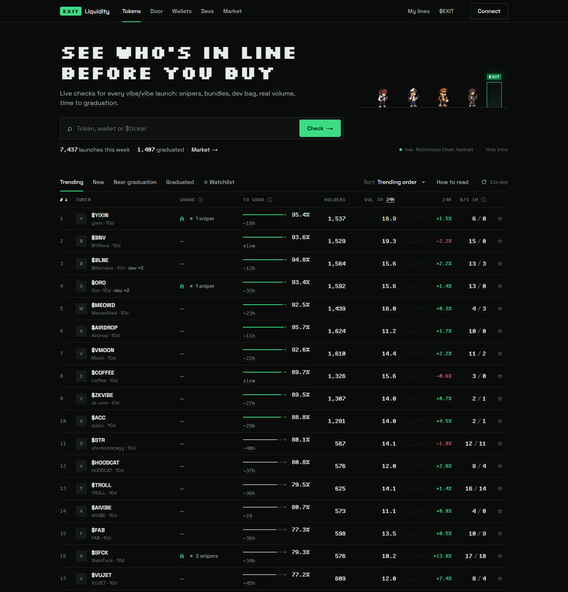
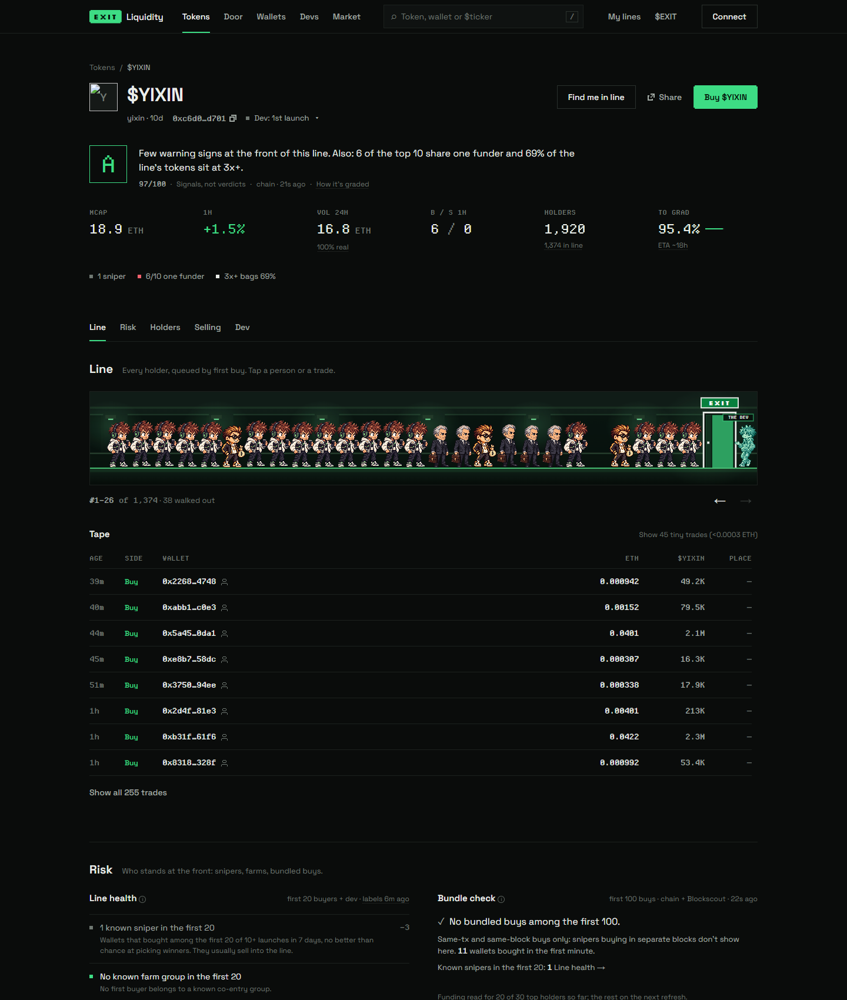
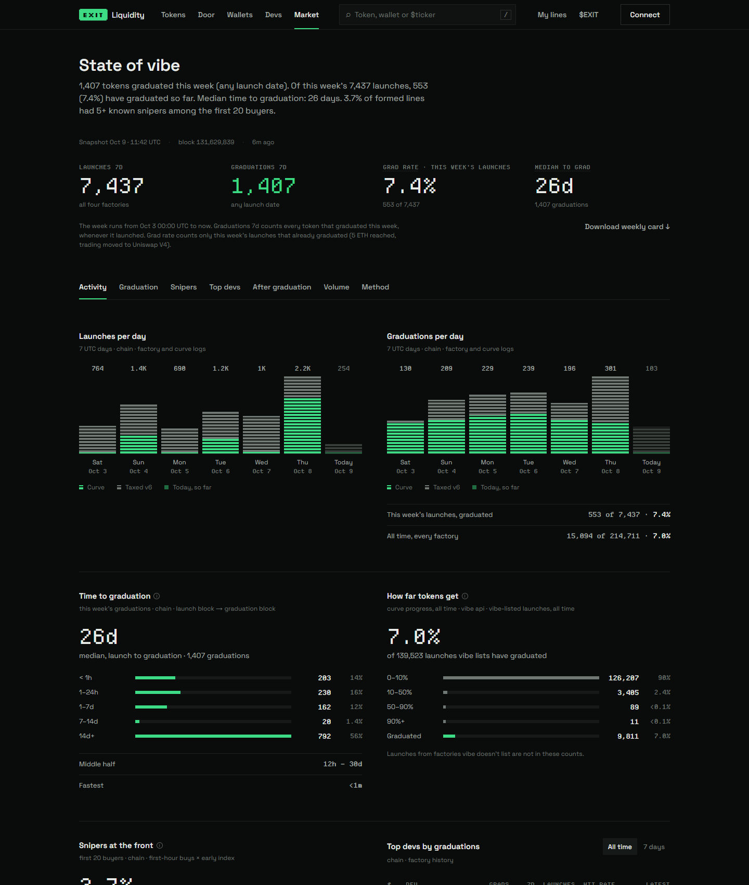

<p align="center">
  
</p>

<h1 align="center">exitliquid.fun</h1>

<p align="center">
  <b>See who's in line before you buy.</b><br>
  Live analytics for every <a href="https://testnet.vibevibe.fun">vibe/vibe</a> launch on Robinhood Chain.
</p>

<p align="center">
  <a href="https://exitliquid.fun"><b>exitliquid.fun</b></a> ·
  <a href="https://exitliquid.fun/methodology">How grades work</a> ·
  <a href="https://exitliquid.fun/state">Market</a> ·
  <a href="https://x.com/exitliqfun">X</a>
</p>

---

Charts show price. They don't show **people**. Every token on vibe/vibe is a line of real holders walking toward the same door: graduation into a Uniswap V4 pool. exitliquid.fun reads that line straight from the chain and tells you who stands in it: snipers, bundles, the dev's bag, real volume and how close the door is. Every token gets one A–F grade with the facts behind it.

<p align="center">
  
  
</p>

## Features

| | What you get |
|---|---|
| **One grade** | A–F for every token: the risk of becoming someone's exit liquidity. Pumps by one wallet, the dev's bag and sells, volume concentration, round-trip trades, holder concentration, pool liquidity, price versus launch. A Full check / Partial marker says what could not be read; nothing unknown counts as clean. |
| **The line** | Every holder as a pixel trader queued to the EXIT door, snipers, farms and bundles marked on the people themselves. Click anyone for their ticket. |
| **Rankings** | The cleanest tokens right now and the worst red flags, re-checked every few minutes. |
| **Bundle check** | Supply bought in the same transaction or block, launch-block and first-minute buyers, shared funders, with tx links as proof. |
| **Who's selling to you** | How much of the line sits in profit (1×, 2×, 3×+), the price if they all sold now, break-even after fees, price impact by size. |
| **Real volume** | Volume without wash trades and bots, buys per buyer, bot share over 1h / 24h / all time. |
| **Holders** | Top 10 without pool and plumbing, gifted vs bought supply, fresh wallets, funding clusters. |
| **Wallet profiles** | Any address: positions with cost and PnL, early entries, sniper / farm / dev tags, who funded it. |
| **Dev history** | On the wallet page: every launch by a creator, how many graduated, whether the dev sold. |
| **Market** | Launchpad-wide stats: launches and graduations per day, time to the door, sniper share, top volume. |
| **Share cards** | One-click pixel cards for any token, wallet or dev, ready to post. |

Every analytics view is open to everyone, with no wallet and no token required.

<p align="center">
  
</p>

## How it works

- **Chain first.** Holders, entries, sells and bundles are rebuilt from Robinhood Chain logs (bonding-curve and Uniswap V4 events). The vibe/vibe API is used for lists and metadata, Blockscout for wallet history and funders.
- **Early Index.** An hourly job reads the first buyers of every launch over the last 7 days and labels wallets that keep entering first without beating chance (snipers) or that keep entering together (farm groups).
- **Unknown is never zero.** If a source doesn't answer, the site says so and shows "—" with a reason. It never shows a clean 0.
- How the grade is built: [exitliquid.fun/methodology](https://exitliquid.fun/methodology).

## Tech

Next.js 16 (App Router) · React 19 · TypeScript · CSS Modules · viem · Privy (optional sign-in) · Upstash Redis (optional cache) · `next/og` for share cards.

## Run locally

```bash
git clone https://github.com/blessedunit/exitliquid.git
cd exitliquid
npm install --legacy-peer-deps
cp .env.example .env.local   # everything in it is optional
npm run dev                  # http://localhost:3000
```

## Disclaimer

Independent community project on the vibe/vibe testnet. Not affiliated with vibe/vibe or Robinhood Markets. Testnet tokens have no value. Nothing here is financial advice.

## License

[MIT](LICENSE)
